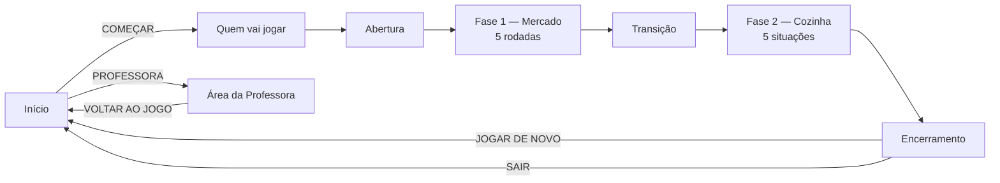

# Na Medida Certa

Jogo web acessível sobre **consumo consciente e desperdício de alimentos**, alinhado à **ODS 12.3** (reduzir pela metade o desperdício de alimentos).
Trabalho da disciplina de Fundamentos de Engenharia de Software — **UTFPR, Equipe 4**.

**Público:** jovens e adultos (16+) com deficiência intelectual atendidos pela **ASSARTE**. O jogo é todo narrado, usa imagens com a palavra embaixo, poucas opções por tela e retorno sempre calmo.

O jogador passa por duas fases:

1. **No mercado:** comprar só a quantidade necessária (contagem de 1 a 5).
2. **Na cozinha:** escolher entre 2 opções, servindo a porção certa e reaproveitando sobras.

A professora tem uma área com senha para cadastrar alunos, ver os relatórios e fazer backup dos resultados.

## Equipe

| Integrante | Papel |
|---|---|
| Davi Beltrame | Product Owner / roteirista |
| Andrey F. de Lima | Scrum Master / desenvolvimento da lógica e relatórios |
| Henrique Tressoldi | Desenvolvimento das telas |
| José Ricardo Baptista | Conteúdo, áudio e imagens |
| Christopher | Qualidade e documentação |

## Como rodar

Abra o `index.html` no Chrome ou no Edge. Não precisa de instalação nem de internet.

Se o navegador bloquear o som ao abrir direto pelo arquivo, rode um servidor local dentro da pasta e acesse `http://localhost:8000`:

```bash
python -m http.server 8000
```

**Áudios:** as falas gravadas ficam em `audio/`, com o nome igual ao código da fala (ex.: `N14.mp3`). Se algum arquivo estiver faltando, o jogo usa a voz sintetizada do navegador.

**Área da professora:** botão PROFESSORA na tela inicial, senha `1234`.

## Arquitetura

- **SPA sem build:** HTML, CSS e JavaScript puros (scripts clássicos em IIFE, sem dependências). Abre direto do arquivo.
- **Máquina de estados de telas (padrão State):** `main.js` mantém a tela atual. Cada tela é registrada com `App.registerScreen(nome, { render, leave })` e a troca é feita por `App.go(nome)`; o `leave()` limpa os timers e o áudio da tela anterior.
- **Repository (`storage.js`):** `Repo` esconde o `localStorage` atrás de uma interface (`getAlunos`, `addAluno`, `getPartidas`, `exportJSON`, `importJSON`...). As telas não acessam o armazenamento diretamente.
- **Facade (`narrator.js`):** uma única interface para falar um código (ex.: `N14`). Tenta o MP3 em `audio/` e, se não existir, usa a voz sintetizada do navegador. Também faz o desbloqueio do áudio no primeiro toque e controla a repetição após 10 s sem ação.
- **Data-driven (`data.js`):** falas, rodadas, situações, imagens e botões ficam em `window.GAME_DATA`. Cada fase é uma única tela que lê os dados da rodada atual, então mudar o conteúdo não exige mexer no código das telas.
- **Relatórios:** cálculos em funções puras (`window.Relatorios.calcularRelatorio1/2` em `professora.js`), que podem ser testadas isoladamente.

## Estrutura de pastas

```
├── index.html              ponto de entrada
├── css/
│   ├── styles.css          design system e telas do jogo
│   └── professora.css      área da professora (+ impressão)
├── js/
│   ├── data.js             conteúdo do jogo (GAME_DATA)
│   ├── sfx.js              efeitos sonoros (Web Audio)
│   ├── narrator.js         narração (MP3 ou voz sintetizada)
│   ├── storage.js          Repository sobre localStorage/JSON
│   ├── main.js             App: máquina de estados e utilitários de DOM
│   ├── screens.js          telas do jogo
│   └── professora.js       área da professora e relatórios
├── img/                    imagens e botões
└── audio/                  falas gravadas (N01.mp3 ... N44.mp3)
```

## Design system

**Estilo cartoon:** contorno escuro grosso, sombra sólida deslocada sem desfoque, cantos bem arredondados e paleta suave.

| Token | Valor |
|---|---|
| Contorno | `5px solid #4A2C17` |
| Raio | `28px` |
| Sombra | `0 8px 0 #4A2C17` (sem blur) |
| Fonte | Arial, CAIXA ALTA (base 20px, subtítulo 28px, título 40px) |
| Fundo | creme `#FFF6E5` |
| Destaques | verde `#4CAF50` / `#C8E6C9`, azul `#BBDEFB`, amarelo `#FFE08A` |

**Regras de acessibilidade do roteiro:**

- Toda tela tem narração e botão **OUVIR DE NOVO**; as opções só ficam clicáveis depois da fala.
- Texto Arial em CAIXA ALTA, no mínimo 16px; títulos e botões com 28px ou mais.
- Itens com no mínimo 150×150px; **CONTINUAR** com no mínimo 300×90px.
- No máximo **2 opções** ou **6 itens** por tela; palavra sempre **abaixo da imagem**.
- Sem cores fortes e sem sustos; erro com retorno calmo e nova tentativa, sem game over.
- Dica piscando após **10 s** sem ação ou no **2º erro**. Só clique ou toque.

## Fluxo de telas



## Riscos tratados no código

Códigos conforme o Plano de Projeto e Análise de Riscos da equipe.

| Risco | Descrição | Solução no projeto |
|---|---|---|
| R06 | Pouco domínio ou limite da licença do Construct 3 | Contingência adotada: HTML + JavaScript, mantendo os dados do roteiro |
| R08 | Áudio e toque falham em tablets e navegadores | Toque inicial que libera o áudio e controles só por clique/toque |
| R09 | Falha ao salvar resultados e relatórios | Registro por rodada, exportar/importar JSON e dados de exemplo na aba DADOS |
| R10 | Gravações com baixa qualidade ou faltando | Voz sintetizada automática para as falas sem arquivo |
| R11 | Acessibilidade mal atendida | Regras do roteiro aplicadas no design system de todas as telas |
