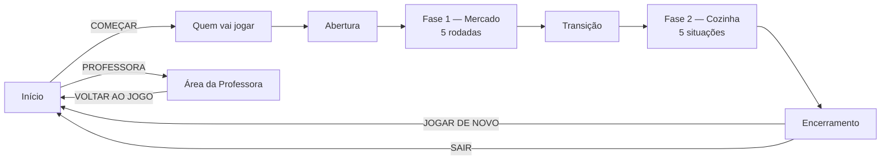

# Na Medida Certa

Jogo web acessível sobre **consumo consciente e desperdício de alimentos**, alinhado à **ODS 12.3** (reduzir pela metade o desperdício de alimentos).
Trabalho da disciplina de Fundamentos de Engenharia de Software — **UTFPR, Equipe 4**.

**Público:** jovens e adultos (16+) com deficiência intelectual atendidos pela **ASSARTE**. O jogo é todo narrado, usa imagens com a palavra embaixo, poucas opções por tela e retorno sempre calmo.

O jogador passa por duas fases:

1. **No mercado:** comprar só a quantidade necessária (contagem de 1 a 5).
2. **Na cozinha:** escolher entre 2 opções, servindo a porção certa e reaproveitando sobras.

A professora tem uma área com senha para cadastrar alunos, ver os relatórios e fazer backup dos resultados.

## Equipe

| Integrante | Papel |
|---|---|
| Davi Beltrame | Product Owner / roteirista |
| Andrey F. de Lima | Scrum Master / desenvolvimento da lógica e relatórios |
| Henrique Tressoldi | Desenvolvimento das telas |
| José Ricardo Baptista | Conteúdo, áudio e imagens |
| Christopher Gomes | Qualidade e documentação |

**Professora (cliente):** Eliana C. M. Ishikawa · **Estudo de caso:** ASSARTE – Associação Artesanal do Excepcional de Ponta Grossa.

| Marco | Data |
|---|---|
| Entrega da documentação e do jogo (Moodle) | 26/11/2026 |
| Apresentação | 30/11/2026 |

## Metodologia

Scrum com sprints de uma semana. O quadro Kanban (Backlog, A fazer, Fazendo, Em revisão, Feito) é a ferramenta visual da sprint, com no máximo 3 tarefas em "Fazendo" por pessoa.

| Cerimônia | Quando | Duração |
|---|---|---|
| Planejamento da sprint | 1ª reunião da semana | até 1 h |
| Daily | Todo dia, em horário fixo | 20 min |
| Revisão da sprint | Fim da sprint | 30 min |
| Retrospectiva | Após a revisão | 15 min |

| Sprint | Período | Entregas |
|---|---|---|
| 0 | 26/10 a 03/11 | Roteiro; Plano de Projeto e Análise de Riscos |
| 1 | 04/11 a 10/11 | Metodologia, requisitos e sistemas similares; telas inicial, escolha do aluno e abertura |
| 2 | 11/11 a 17/11 | Documento de requisitos, casos de uso e protótipo; Fase 1; registro de resultados |
| 3 | 18/11 a 24/11 | Fase 2, transição e encerramento; área da professora; formulário ISO/IEC 25010; testes |
| 4 | 25/11 a 26/11 | Correções finais e entrega no Moodle |
| 5 | 27/11 a 30/11 | Ensaio e apresentação |

## Como rodar

Abra o `index.html` no Chrome ou no Edge. Não precisa de instalação nem de internet.

Se o navegador bloquear o som ao abrir direto pelo arquivo, rode um servidor local dentro da pasta e acesse `http://localhost:8000`:

```bash
python -m http.server 8000
```

**Áudios:** as falas gravadas ficam em `audio/`, com o nome igual ao código da fala (ex.: `N14.mp3`). Se algum arquivo estiver faltando, o jogo usa a voz sintetizada do navegador.

**Área da professora:** botão PROFESSORA na tela inicial, senha `1234`.

## Arquitetura

- **SPA sem build:** HTML, CSS e JavaScript puros (scripts clássicos em IIFE, sem dependências). Abre direto do arquivo.
- **Máquina de estados de telas (padrão State):** `main.js` mantém a tela atual. Cada tela é registrada com `App.registerScreen(nome, { render, leave })` e a troca é feita por `App.go(nome)`; o `leave()` limpa os timers e o áudio da tela anterior.
- **Repository (`storage.js`):** `Repo` esconde o `localStorage` atrás de uma interface (`getAlunos`, `addAluno`, `getPartidas`, `exportJSON`, `importJSON`...). As telas não acessam o armazenamento diretamente.
- **Facade (`narrator.js`):** uma única interface para falar um código (ex.: `N14`). Tenta o MP3 em `audio/` e, se não existir, usa a voz sintetizada do navegador. Também faz o desbloqueio do áudio no primeiro toque e controla a repetição após 10 s sem ação.
- **Data-driven (`data.js`):** falas, rodadas, situações, imagens e botões ficam em `window.GAME_DATA`. Cada fase é uma única tela que lê os dados da rodada atual, então mudar o conteúdo não exige mexer no código das telas.
- **Relatórios:** cálculos em funções puras (`window.Relatorios.calcularRelatorio1/2` em `professora.js`), que podem ser testadas isoladamente.

## Estrutura de pastas

```
├── index.html              ponto de entrada
├── css/
│   ├── styles.css          design system e telas do jogo
│   └── professora.css      área da professora (+ impressão)
├── js/
│   ├── data.js             conteúdo do jogo (GAME_DATA)
│   ├── sfx.js              efeitos sonoros (Web Audio)
│   ├── narrator.js         narração (MP3 ou voz sintetizada)
│   ├── storage.js          Repository sobre localStorage/JSON
│   ├── main.js             App: máquina de estados e utilitários de DOM
│   ├── screens.js          telas do jogo
│   └── professora.js       área da professora e relatórios
├── img/                    imagens e botões
└── audio/                  falas gravadas (N01.mp3 ... N44.mp3)
```

## Design system

**Estilo cartoon:** contorno escuro grosso, sombra sólida deslocada sem desfoque, cantos bem arredondados e paleta suave.

| Token | Valor |
|---|---|
| Contorno | `5px solid #4A2C17` |
| Raio | `28px` |
| Sombra | `0 8px 0 #4A2C17` (sem blur) |
| Fonte | Arial, CAIXA ALTA (base 20px, subtítulo 28px, título 40px) |
| Fundo | creme `#FFF6E5` |
| Destaques | verde `#4CAF50` / `#C8E6C9`, azul `#BBDEFB`, amarelo `#FFE08A` |

**Regras de acessibilidade do roteiro:**

- Toda tela tem narração e botão **OUVIR DE NOVO**; as opções só ficam clicáveis depois da fala.
- Texto Arial em CAIXA ALTA, no mínimo 16px; títulos e botões com 28px ou mais.
- Itens com no mínimo 150×150px; **CONTINUAR** com no mínimo 300×90px.
- No máximo **2 opções** ou **6 itens** por tela; palavra sempre **abaixo da imagem**.
- Sem cores fortes e sem sustos; erro com retorno calmo e nova tentativa, sem game over.
- Dica piscando após **10 s** sem ação ou no **2º erro**. Só clique ou toque.
- **A Fase 1 é um tutorial de aprendizagem sem erro** (*errorless learning*; Mueller, Palkovic e Maynard, 2007): a cesta aceita só a quantidade pedida e cada toque é contado em voz alta, para o aluno praticar a contagem de 1 a 5 sempre com o modelo certo. O único erro registrado é tocar com a cesta cheia. A Fase 2 é a etapa de aplicação, em que o aluno pode errar e tenta de novo.

## Fluxo de telas



## Casos de uso

| Ator | Casos de uso |
|---|---|
| Aluno | UC01 Liberar o áudio · UC02 Escolher o jogador · UC03 Assistir à abertura · UC04 Jogar a Fase 1 · UC05 Jogar a Fase 2 · UC06 Ouvir de novo · UC07 Ver o encerramento |
| Professora | UC08 Entrar com senha · UC09 Gerenciar alunos · UC10 Consultar Relatório 1 · UC11 Consultar Relatório 2 · UC12 Fazer backup dos dados |
| Sistema | UC13 Registrar resultado (incluído por UC04 e UC05) |

## Requisitos

### Funcionais

| Código | Requisito | Situação |
|---|---|---|
| RF01 | Liberar o áudio com um toque inicial (TOCAR PARA COMEÇAR) | Atendido |
| RF02 | Escolher o jogador pela foto ou inicial; sem alunos, jogar como VISITANTE | Atendido |
| RF03 | Abertura em 4 quadros narrados, com botão PULAR | Atendido |
| RF04 | Fase 1: encher a cesta com a quantidade pedida, com a contagem falada | Atendido |
| RF05 | Fase 2: escolher entre 2 opções em 5 situações, com nova tentativa no erro | Atendido |
| RF06 | Repetir a última fala pelo botão OUVIR DE NOVO | Atendido |
| RF07 | Dica após 10 s sem ação ou no 2º erro | Atendido |
| RF08 | Registrar por rodada: erros, dica, acerto de primeira, tempo e data | Atendido |
| RF09 | Área da professora com senha de 4 dígitos em teclado na tela | Atendido |
| RF10 | Cadastrar e remover alunos, com foto opcional (200 × 200 px) | Atendido |
| RF11 | Relatório 1: desempenho do aluno em uma partida, com impressão | Atendido |
| RF12 | Relatório 2: evolução da turma, com impressão | Atendido |
| RF13 | Exportar/importar JSON, carregar dados de exemplo e apagar tudo | Atendido |

### Não funcionais

| Código | Categoria | Requisito | Situação |
|---|---|---|---|
| RNF01 | Acessibilidade | Arial em CAIXA ALTA, mínimo 16 px; títulos e botões com 28 px ou mais | Atendido |
| RNF02 | Acessibilidade | Itens com no mínimo 150 × 150 px; CONTINUAR com 300 × 90 px | Atendido |
| RNF03 | Acessibilidade | No máximo 2 opções ou 6 itens por tela; palavra abaixo da imagem | Atendido |
| RNF04 | Acessibilidade | Toda tela narrada (45 falas gravadas) e legendada; opções bloqueadas durante a fala | Atendido |
| RNF05 | Usabilidade | Só clique ou toque, com proteção contra toque duplo (350 ms) | Atendido |
| RNF06 | Usabilidade | Sem cronômetro, pontos negativos ou sustos | Atendido |
| RNF07 | Portabilidade | Chrome ou Edge, computador e tablet, sem internet | Atendido |
| RNF08 | Confiabilidade | Salvar após cada rodada | Atendido |
| RNF09 | Segurança | Dados do aluno inseridos só como texto (sem `innerHTML`) | Atendido |
| RNF10 | Segurança | Área da professora protegida por senha | Parcial (ver P1) |
| RNF11 | Manutenibilidade | Conteúdo separado do código das telas (`data.js`) | Atendido |

## Modelo de dados

Chave `nmc_dados_v1` no `localStorage`:

| Entidade | Campos |
|---|---|
| Aluno | `id`, `nome`, `foto`, `criadoEm` |
| Partida | `id`, `alunoId`, `alunoNome`, `inicio`, `fim`, `registros[]` |
| Registro | `fase`, `rodada`, `erros`, `usouDica`, `acertouPrimeira`, `tempoMs`, `dataHora` |

## Testes

Os testes são manuais, no Chrome e no Edge, em computador e tablet. O projeto não tem testes automatizados.

| Código | Cenário | Resultado esperado |
|---|---|---|
| CT01 | Tocar em TOCAR PARA COMEÇAR | A tela inicial fala N01 e libera COMEÇAR depois da fala |
| CT02 | Abrir "Quem vai jogar?" sem alunos | Aparece só o cartão VISITANTE |
| CT03 | Fase 1, rodada 1: tocar em 2 pães | A cesta enche, toca o elogio N15 e surge CONTINUAR |
| CT04 | Fase 1: tocar com a cesta cheia | Fala N13 e conta 1 erro |
| CT05 | Fase 2: errar duas vezes | No 2º erro a opção certa pisca |
| CT06 | Ficar 10 s sem tocar | A dica pisca e a instrução é repetida |
| CT07 | Senha errada | Mensagem de senha incorreta e campo limpo |
| CT08 | Jogar e abrir o Relatório 1 | 10 linhas (5 por fase) |
| CT09 | Exportar, apagar tudo e importar | Os dados voltam como estavam |
| CT10 | Imprimir o Relatório 2 | Só a tabela sai na impressão |

## Problemas conhecidos

| # | Problema | Onde |
|---|---|---|
| P1 | A senha da professora (`1234`) está fixa no código | `js/data.js` |

Outras limitações:

- JOGAR DE NOVO e SAIR fazem a mesma coisa (voltam ao início).
- A partida é salva ao escolher o aluno; partidas abandonadas aparecem no Relatório 1 sem rodadas.
- Na situação 1 da Fase 2, "2 pessoas" e "5 pratos" usam emojis no lugar de fotos.

## Trabalhos futuros

- Permitir que a professora troque a senha e guardá-la como hash, fora do código.
- Depois do tutorial da Fase 1, acrescentar um nível de desafio em que o próprio aluno decide quando a cesta está completa, para medir a contagem sem apoio.
- Trocar os emojis da situação 1 por fotos reais.
- Aplicar os formulários ISO/IEC 25010 com alunos e professores da ASSARTE.
- Criar testes automatizados para `calcularRelatorio1` e `calcularRelatorio2`.

## Riscos tratados no código

Códigos conforme o Plano de Projeto e Análise de Riscos da equipe.

| Risco | Descrição | Solução no projeto |
|---|---|---|
| R06 | Pouco domínio ou limite da licença do Construct 3 | Contingência adotada: HTML + JavaScript, mantendo os dados do roteiro |
| R08 | Áudio e toque falham em tablets e navegadores | Toque inicial que libera o áudio e controles só por clique/toque |
| R09 | Falha ao salvar resultados e relatórios | Registro por rodada, exportar/importar JSON e dados de exemplo na aba DADOS |
| R10 | Gravações com baixa qualidade ou faltando | Voz sintetizada automática para as falas sem arquivo |
| R11 | Acessibilidade mal atendida | Regras do roteiro aplicadas no design system de todas as telas |
