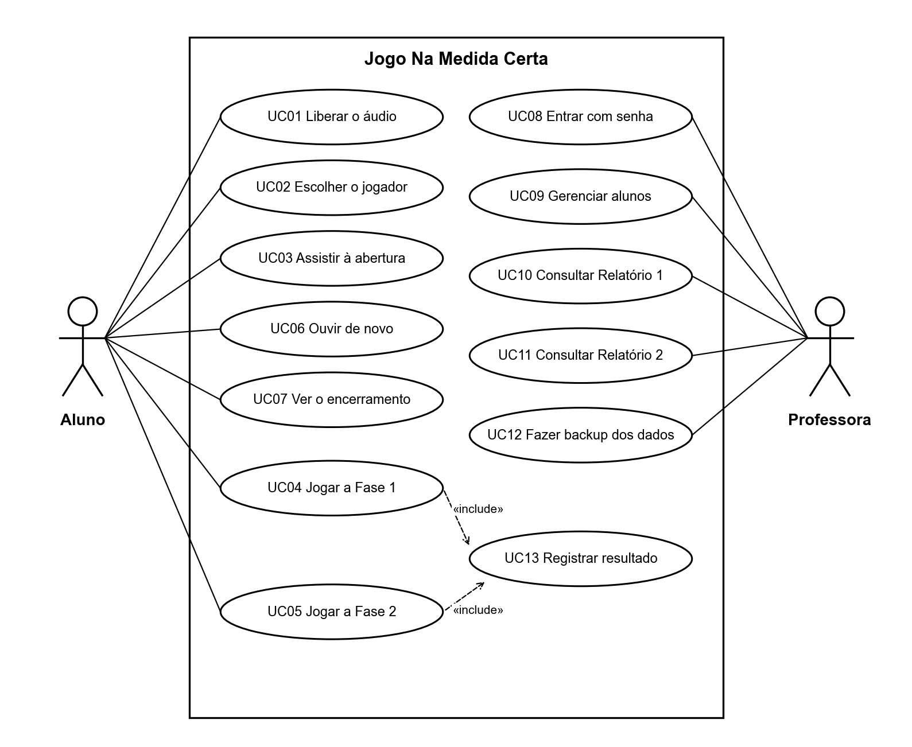
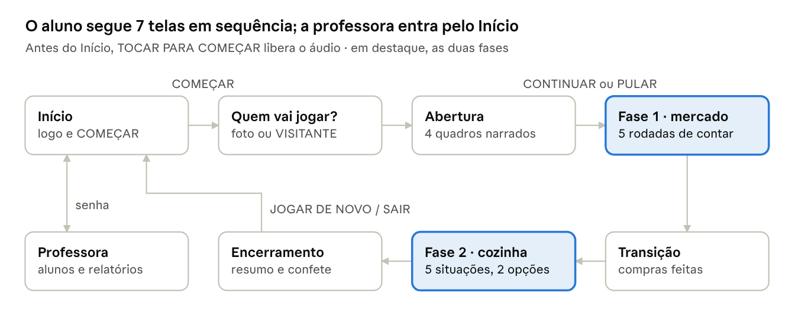

# Documentação — Na Medida Certa

Documentação formal do projeto, no padrão da UTFPR (NBR 14724), entregue na disciplina de Fundamentos de Engenharia de Software — Equipe 4.

| Arquivo | Conteúdo |
|---|---|
| [Na-Medida-Certa_Documentacao.pdf](Na-Medida-Certa_Documentacao.pdf) | Documento completo (34 páginas): metodologia Scrum, levantamento de requisitos, sistemas similares, documento de requisitos, protótipos das telas, arquitetura, formulários de qualidade ISO/IEC 25010, testes, instalação e referências |
| [arquitetura.png](arquitetura.png) | Figura 1 — Arquitetura do código em camadas |
| [diagrama-casos-de-uso.png](diagrama-casos-de-uso.png) | Figura 2 — Diagrama de casos de uso |
| [fluxo-de-telas.png](fluxo-de-telas.png) | Figura 3 — Fluxo de navegação entre as telas |

O [README principal](../README.md) traz um resumo navegável da mesma documentação.

## Figuras

### Arquitetura do código

### Casos de uso

### Fluxo de telas

